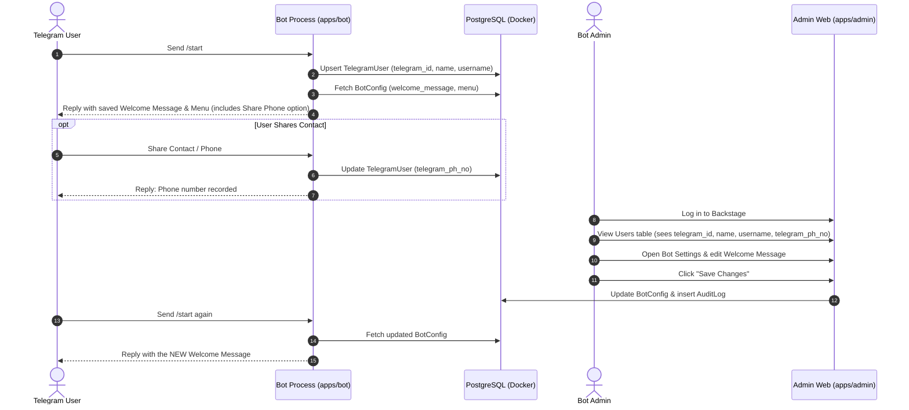
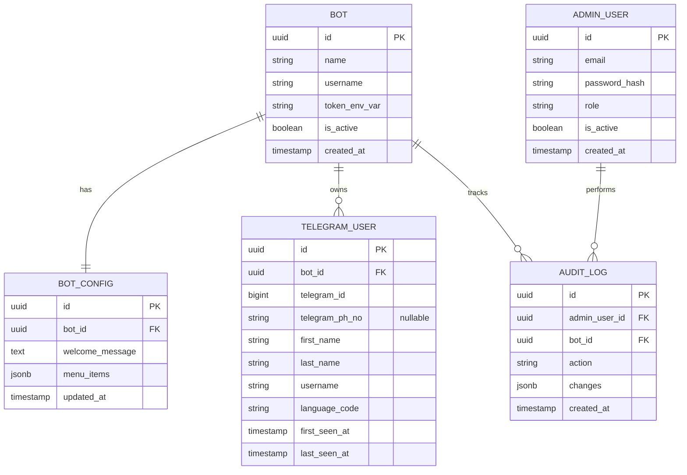
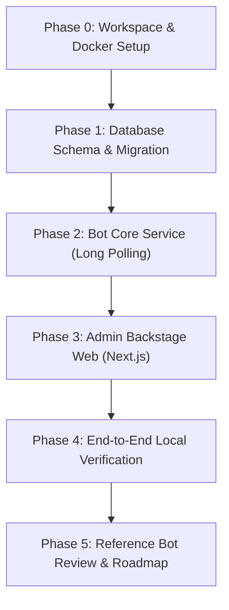

# Telegram Bot Backstage — Project Master Plan (MVP)

> **Document Status**: Draft / Approved for Phase Planning  
> **Target Environment**: Windows (x64, ~16 GB RAM), Local Development  
> **Mode**: Planning Only (No code implementation until plan review)

---

## 1. Project Overview & Boundaries

### 1.1 Goal
Build a local, web-based administrative backstage panel for managing the owner's personal Telegram bots, alongside a single working test bot. The system will initially handle a single test bot, but the database architecture is designed with a `bot_id` discriminator from Day 1 to allow multiple personal bots in the future without schema overhauls.

### 1.2 Critical Boundaries & Rules
- **Separate Project**: Independent repository and codebase. No connection or access to the *Good Win* project.
- **Local Development Only**: No cloud or production deployment in this phase.
- **No Speculative Complex Features**: Payments, digital wallets, betting, bulk broadcasting, and multi-tier referral programs are strictly excluded until explicitly requested and verified.
- **Credential Hygiene**: Bot tokens and admin passwords remain strictly inside local `.env` files. No credentials will ever be pasted into chat or committed to version control.
- **Unverified Status for Reference Bot**: Features of `@UnitySpaceBot` are marked **UNVERIFIED** and will not be designed or coded until visual proof (screenshots or video recordings) is supplied.

---

## 2. Directory Inspection Result

- **Current Workspace**: `c:\Users\JM505 Computers\Documents\BackStage`
- **Current State**: Verified completely empty (0 files, 0 folders).
- **Environment Discovery**:
  - Node.js: `v24.21.0` (Installed)
  - Git: `2.55.0.windows.5` (Installed)
  - Docker: `29.8.0` with Docker Compose `v5.5.1` (Installed)
  - PowerShell Execution Policy: Requires `Set-ExecutionPolicy -Scope CurrentUser RemoteSigned` or using `npm.cmd` due to Windows script execution restriction on `npm.ps1`.

---

## 3. Proposed Architecture & Project Structure

We recommend an **npm workspaces** layout. It keeps the admin dashboard and bot runner cleanly separated while sharing the database models and TypeScript types:

```text
BackStage/
├── .env.example                  # Template for local environment variables
├── .gitignore                    # Node, Next.js, and environment ignores
├── docker-compose.yml            # Local PostgreSQL container specification
├── package.json                  # Root workspace config and unified script runner
├── tsconfig.json                 # Base shared TypeScript settings
│
├── apps/
│   ├── admin/                    # Next.js Backstage Web Application
│   │   ├── src/
│   │   │   ├── app/              # Next.js App Router (Dashboard, Settings, Login)
│   │   │   ├── components/       # UI elements (Forms, Tables, Layout)
│   │   │   └── lib/              # Auth, server actions, and DB queries
│   │   ├── package.json
│   │   └── tsconfig.json
│   │
│   └── bot/                      # Node.js Telegram Bot Service
│       ├── src/
│       │   ├── handlers/         # /start command, menu button handlers
│       │   ├── services/         # User sync, config retrieval
│       │   └── index.ts          # Bot bootstrap & Telegram long polling loop
│       ├── package.json
│       └── tsconfig.json
│
├── packages/
│   └── db/                       # Centralized Database Package
│       ├── prisma/               # Prisma Schema & Migration files
│       │   └── schema.prisma
│       ├── src/                  # Generated Client export
│       └── package.json
│
└── docs/                         # Specifications and Documentation
    └── PROJECT_PLAN.md           # This master planning document
```

### Component Breakdown
1. **`apps/admin` (Next.js)**: Runs on `http://localhost:3000`. Provides an authenticated web GUI for the bot owner to view registered Telegram users and edit bot configurations (e.g., welcome message).
2. **`apps/bot` (Node.js + grammY)**: A standalone Node.js process using Telegram Long Polling. Long polling requires **no public IP, domain, or SSL tunnel** (unlike webhooks), making it robust and safe for local Windows development.
3. **`packages/db` (Prisma + PostgreSQL)**: Shared data layer so both the admin web app and the bot process reference the exact same type-safe schema and database queries.
4. **`docker-compose.yml`**: Spins up a local, lightweight PostgreSQL 16 instance with persistent local disk storage.

---

## 4. MVP Feature List & Acceptance Criteria

### MVP Flow


### Acceptance Criteria
- [ ] **AC-1 (Database Service)**: `docker compose up -d` starts PostgreSQL without error and data persists across container restarts.
- [ ] **AC-2 (User Upsert & Data Capture)**:
  - Sending `/start` to the test bot creates or updates a `TelegramUser` record with `telegram_id`, `name` (`first_name` + optional `last_name`), and `username`, while updating `last_seen_at`.
  - When the user shares their phone number (via Telegram contact-share button or message), the bot records/updates `telegram_ph_no` on that user's record in PostgreSQL.
- [ ] **AC-3 (Configurable Greeting)**: Bot reads its welcome message dynamically from the database.
- [ ] **AC-4 (Admin Authentication)**: Access to `http://localhost:3000` requires local admin credentials (hashed password verification).
- [ ] **AC-5 (User Visibility)**: Admin dashboard displays a paginated list of recorded Telegram users showing `telegram_id`, `name`, `username`, `telegram_ph_no`, `first_seen_at`, and `last_seen_at`.
- [ ] **AC-6 (Live Config Editing)**: Admin edits the welcome message in the UI; subsequent `/start` commands immediately reflect the new text without restarting the bot runner.

---

## 5. Unverified Features List (@UnitySpaceBot)

> [!WARNING]
> The reference bot `@UnitySpaceBot` has **NOT** yet been verified. To avoid technical debt and wasted development time, all features outside the core MVP are classified as **UNVERIFIED** and deferred until screenshots/recordings are provided:

| Feature Area | Assumption / Unverified Item | Reason for Deferral |
| :--- | :--- | :--- |
| **Monetization & Payments** | In-bot Stars, Crypto, Stripe, or manual invoices | Financial flow unverified; requires strict compliance. |
| **Wallets & Balances** | User balance tracking, deposits, withdrawals | High risk; security and transaction ledger needed. |
| **Betting / Gaming** | Dice games, lotteries, prediction markets | Out of scope; unverified mechanic. |
| **Broadcast Engine** | Mass messaging, segment filtering, rate limiting | Telegram rate limits require dedicated queue (e.g. BullMQ). |
| **Referrals & Affiliates** | Deep-link tracking (`/start ref123`), multi-level commissions | Schema and calculation rules unknown. |
| **Telegram Mini App (TMA)** | WebApp modals inside Telegram | Requires separate HTTPS build and Telegram WebApp SDK. |
| **Automated Chat AI** | LLM responses to user messages | Token cost and prompting requirements unverified. |
| **Complex Menus** | Multi-level nested inline keyboards | Needs reference UI breakdown. |

---

## 6. Proposed Database Entities (PostgreSQL via Prisma)

Every bot-specific table includes a `bot_id` foreign key. This ensures data separation when additional bots are connected in future phases.



### Entity Specifications
1. **`Bot`**: Metadata for registered bots. Stores `token_env_var` (name of the environment variable containing the token) rather than plaintext tokens in the database.
2. **`BotConfig`**: Key configuration for the bot (1:1 with `Bot`). Contains the `welcome_message` and optional JSON menu layout.
3. **`TelegramUser`**: Telegram users interacting with each bot. Stores `telegram_id` (Telegram 64-bit user ID), `telegram_ph_no` (E.164 formatted string, nullable until user shares contact), `first_name`, `last_name` (representing user name), `username`, and activity timestamps. Composite unique index: `@@unique([bot_id, telegram_id])`.
4. **`AdminUser`**: Admin accounts for logging into the backstage web app.
5. **`AuditLog`**: Records changes made in the admin panel (who changed what, previous value, new value).

---

## 7. Windows Local Setup Prerequisites & Notes

### Hardware & OS
- OS: Windows 10/11 (64-bit)
- RAM: ~16 GB (comfortable for running Docker PostgreSQL + Next.js Dev Server + Node Bot runner simultaneously).

### Tooling Status & Fixes
1. **Node.js**: `v24.21.0` installed.
2. **Docker Desktop**: Docker `29.8.0` installed.
   - *Requirement*: Docker Desktop must be running in the background before starting database containers.
3. **PowerShell Script Policy Fix**:
   - Running `npm` directly inside standard PowerShell may yield an execution policy restriction (`npm.ps1 cannot be loaded`).
   - *Solution*: Run `Set-ExecutionPolicy -Scope CurrentUser -ExecutionPolicy RemoteSigned` in PowerShell, or invoke via `npm.cmd`.
4. **Telegram Test Bot**:
   - Created via Telegram `@BotFather`.
   - Obtain a test bot token and store it exclusively in local `.env` as `TEST_BOT_TOKEN=...`.

---

## 8. Security & Operational Requirements

### 8.1 Admin Authentication & Session Safety
- Local authentication using secure HTTP-only cookies.
- Password hashing using **Argon2id** or **bcrypt** (minimum 12 salt rounds).
- No hardcoded admin credentials in code. Seed script will create an initial local admin with credentials specified in `.env`.

### 8.2 Bot Token Handling
- Tokens are **strictly secrets**. Never output bot tokens in console logs, commit them to Git, or expose them via `NEXT_PUBLIC_` variables.
- The bot process reads tokens directly from `process.env`.
- Database stores only the environment key alias (e.g., `TEST_BOT_TOKEN`) or encrypted strings.

### 8.3 Role-Based Access Control (RBAC Foundation)
- Initial roles: `SUPER_ADMIN` (full control) and `VIEWER` (read-only for user list).
- UI buttons to edit settings are disabled or hidden for non-admin roles.

### 8.4 Logging & Privacy
- Telegram user messages other than commands are not logged by default.
- Redact tokens and authentication headers from server logs.
- Audit logging for every configuration change (record admin ID, timestamp, and field modified).

### 8.5 Local Backups & Persistence
- PostgreSQL data directory mounted to a named Docker volume (`pgdata`) to survive container restarts and rebuilds.
- Simple Windows PowerShell backup script (`scripts/backup-db.ps1`) to run `pg_dump` into a `backups/` folder.

---

## 9. Phased Implementation Plan



### Phase 0: Workspace Foundation & Docker Setup
- Initialize Git repository and `.gitignore`.
- Set up root `package.json` with npm workspaces (`apps/admin`, `apps/bot`, `packages/db`).
- Create `docker-compose.yml` for PostgreSQL 16.
- Create `.env.example` with documented variable keys.

### Phase 1: Database Layer (`packages/db`)
- Initialize Prisma with PostgreSQL provider.
- Define schema (`Bot`, `BotConfig`, `TelegramUser`, `AdminUser`, `AuditLog`).
- Run initial migration to create local tables.
- Create seed script for default bot record and initial admin user.

### Phase 2: Bot Core Runtime (`apps/bot`)
- Scaffold Node.js TypeScript project with **grammY** framework.
- Implement Telegram long polling connection.
- Implement `/start` handler:
  - Upsert user record in `TelegramUser` (`telegram_id`, `name`, `username`).
  - Fetch welcome message from `BotConfig`.
  - Send message and menu buttons (including optional "Share Phone Number" contact button).
- Implement contact/phone handler:
  - Capture shared contact payload and update `telegram_ph_no` on the `TelegramUser` record.
- Handle graceful shutdown (SIGINT/SIGTERM).

### Phase 3: Admin Backstage Web (`apps/admin`)
- Scaffold Next.js 14/15 App Router application with Tailwind CSS.
- Implement simple local session auth (Login page).
- Build Dashboard:
  - Display summary cards (total users, active bot status).
  - Data table showing Telegram users (filtered by `bot_id`).
- Build Bot Settings page:
  - Form to update the welcome message and inline menu.
  - Form submission updates `BotConfig` and creates an `AuditLog` entry.

### Phase 4: Verification & Acceptance Testing
- Run test scenario end-to-end:
  1. Boot Docker, Admin Web, and Bot runner.
  2. Send `/start` from Telegram app.
  3. Confirm user appears in Admin Web table.
  4. Edit welcome message in Admin Web.
  5. Send `/start` again in Telegram; verify immediate update.

### Phase 5: Reference Bot Review (@UnitySpaceBot)
- Receive and review user's screenshots or video clips of `@UnitySpaceBot`.
- Map verified screens to proposed new database fields and UI tabs.
- Prepare Phase 2 scope document before writing any new code.

---

## 10. Basic Verification Plan

| Test Case | Precondition | Action | Expected Outcome |
| :--- | :--- | :--- | :--- |
| **V-01: DB Health** | Docker running | `docker compose up -d` | Postgres is healthy on port 5432; tables exist. |
| **V-02a: User Profile Capture** | Bot running | Telegram user clicks `/start` | Record created/updated in `telegram_user` with `telegram_id`, `name`, `username`. |
| **V-02b: Phone Number Capture** | Bot running | Telegram user shares contact/phone | `telegram_ph_no` updated on existing user record in `telegram_user`. |
| **V-03: Dynamic Greeting** | Bot running | Telegram user clicks `/start` | Bot returns current DB `welcome_message`. |
| **V-04: Admin Auth** | Admin web running | Navigate to `http://localhost:3000` | Redirected to `/login`; invalid password rejected; valid accepted. |
| **V-05: User List Display** | Admin logged in | Navigate to `/users` | Table displays captured Telegram user (`telegram_id`, `name`, `username`, `telegram_ph_no`). |
| **V-06: Config Update** | Admin logged in | Edit text in `/settings` and submit | DB record updated; audit record created. |
| **V-07: Live Update** | Bot running | Send `/start` again in Telegram | Bot displays updated text without needing a process restart. |

---

## 11. Assumptions Log

1. **Long Polling Sufficiency**: We assume local Telegram long polling is acceptable for development without setting up ngrok or reverse proxies.
2. **Single Admin User**: We assume one local super admin user is sufficient for the initial MVP.
3. **Bot Token Provisioning**: We assume the user has access to Telegram's `@BotFather` to create a dedicated test bot.
4. **npm Workspaces**: We assume npm workspaces provide an adequate monorepo experience without introducing heavier tools like Turborepo.
